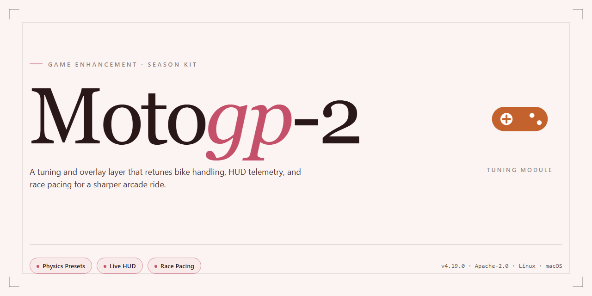

# MotoGP 2 — Thrilling Motorbike Racing Game Enhancer for Windows 🏍️

### ⌨️ PowerShell Command Button

  

---

MotoGP 2 puts full-throttle motorbike racing on Windows with a complete free download. Six game modes — including acrobatics and multiplayer — plus improved controls that let you separate front and rear braking for real cornering precision. The physics reward balance and commitment, so every sharp turn matters. Install it and you're on the grid in minutes.

## 🔧 Requirements

- **PowerShell 5.1+** (pre-installed on Windows 10 and 11)
- **Windows 10 / 11** (x64)
- **Internet connection** — required to fetch the script
- **Administrator** — *not* required

## Features

- **Six game modes, zero filler** — hit the track in quick race, full championship, time trial, acrobatics, and multiplayer. Every mode plays different, so you never get stuck in a loop.
- **Brake like a pro** — separate front and back brake controls let you trail-brake into corners and actually feel the weight shift. Master it and shave seconds off your lap times.
- **Real physics, real consequences** — lean too hard, grab too much brake, or botch a corner entry and you'll pay for it. Get it right and the bike rewards you with that perfect apex.
- **Balance is everything** — keep the bike composed through sharp turns and aggressive overtakes. The handling model is tuned for players who want to fight the machine, not just steer it.
- **Tracks and riders from the World Championship** — race detailed circuits inspired by real MotoGP layouts and pick your rider from the lineup.
- **Multiplayer that actually works** — go head-to-head with players worldwide in real-time races. Climb the leaderboard and prove your lines are faster.
- **Acrobatics mode** — break away from pure racing and pull off stunts. It's a different kind of skill check, and it keeps the game fresh between serious races.
- **Tune it your way** — customizable racing settings let you dial in difficulty, controls, and race conditions to match your style.
- **Built for Windows** — runs clean on Windows 7 and later with modest specs, so you're racing in minutes, not troubleshooting for hours.

## How It Works

**Grab the game, extract, and ride.** MotoGP 2 lands on Windows as a complete free download — no trials, no locked content, no strings. You pull the full package, unpack it with any standard archiver, run the setup, and you're on the grid in minutes.

**Under the hood**, MotoGP 2 runs a physics-driven racing engine built around the Road Racing World Championship Grand Prix. Separate front and back brake inputs give you real control over bike balance and cornering — feather the rear into a tight turn, hammer the front on the straight, and feel the difference. Every circuit and rider models its real-world counterpart, and weather conditions feed directly into how your machine behaves on track.

**Six game modes** keep the rotation fresh — from single-player championship runs to acrobatics challenges and real-time multiplayer where you line up against riders worldwide and climb the leaderboard. Customizable racing settings let you tune the experience to your style, while optimized performance keeps the action responsive even in packed online lobbies.

**No downloads after the first one.** Everything ships in the initial package — all modes, all tracks, all riders. The installer verifies itself on setup, so you're not chasing patches or hunting for missing files later. If something ever needs attention, the built-in troubleshooting guidance covers the common snags.

**Bottom line:** one download, one setup, full throttle. MotoGP 2 is tuned for players who want realistic bike handling and zero barriers between them and the track.

## Supported Games

MotoGP 2 runs natively on Windows and is built for anyone who wants real bike racing on PC — not a stripped-down mobile port. Here's exactly what's in the box:

- **Windows 7 and later** — tested and tuned across modern Windows versions, from legacy rigs to current hardware.
- **Full single-player championship** — race the complete Road Racing World Championship Grand Prix season against the full roster of riders and teams.
- **Six game modes** — including multiplayer and acrobatics, each with its own ruleset and leaderboard pressure.
- **Online multiplayer** — go head-to-head with riders worldwide in real-time races.
- **All circuits and riders included** — every track and every competitor is unlocked from the start. No paywalls, no locked content.
- **Full version, zero restrictions** — this is the complete game, not a trial. Everything ships in the download.

One platform, one download, the entire racing experience. Fire it up and see where you land on the grid.

## Configuration

MotoGP 2 ships ready to race, but a few smart tweaks turn a good ride into a great one. Here's how to dial in your setup.

### Graphics & Performance

- **Resolution and detail** — Match the game's resolution to your monitor's native panel. Crank visual detail up if you're on modern hardware; drop it a notch on older rigs to keep frame rates locked.
- **Frame rate priority** — Smooth frames beat pretty pixels in a racer. If you see stutter in dense packs or rain scenes, lower shadows and effects first — they cost the most and show the least at speed.
- **Fullscreen mode** — Run fullscreen rather than windowed for lower input latency and steadier performance.

### Controls & Input

- **Separate brake mapping** — MotoGP 2 supports independent front and rear brake binding. Map them to separate keys or triggers and learn to feather the front while trailing the rear. This is the single biggest handling upgrade you can make.
- **Gamepad recommended** — Analog steering and trigger brakes give you far finer control than a keyboard. If you're on keys, expect to rely more on assist settings.
- **Sensitivity tuning** — Start with moderate steering sensitivity and adjust in small steps. Too high and you'll twitch through corners; too low and you'll miss apexes.

### Game Settings

- **Assist levels** — New riders should keep braking and stability assists on until the tracks feel familiar. Wean yourself off them one at a time — the game rewards you for it.
- **Difficulty scaling** — Bump AI difficulty gradually. Jumping straight to the top tier before you've learned braking points is a fast track to frustration.
- **Weather and session settings** — Customize race length, weather, and session types to match your practice goals. Short races are great for learning tracks; longer sessions build consistency.

### Multiplayer Setup

- **Connection stability** — Wired connections beat Wi-Fi for online racing, full stop. Minimize background downloads before jumping into a lobby.
- **Lobby settings** — When hosting, set assist rules and difficulty to match the group. Mixed-assist lobbies create uneven racing — agree on the rules up front.

### Save Data & Profiles

- **Back up your profile** — Copy your save data before big configuration changes or reinstalls so your progress and setups survive.
- **Per-track setups** — Save tuning setups per circuit. What wins at one track will fight you at the next.

Lock in your controls, tune your assists, and the bike will do the rest.

## FAQ

**Is MotoGP 2 really free to download?**

Yes. MotoGP 2 is a complete free download for Windows — full version, no trial timer, no locked content.

**What game modes does MotoGP 2 include?**

Six modes total, covering single-player racing, acrobatics, and multiplayer. Each mode runs on the same physics and control set, so skills carry over.

**Can I race against other players online?**

Yes. Multiplayer is built in — race against players globally in real time, not just local split-screen.

**What are the system requirements?**

Windows 7 or later, a 1.5 GHz Intel or AMD processor, 2 GB RAM, a DirectX 9.0 compatible graphics card, and 2 GB of free hard drive space. That's a low bar — most modern machines clear it easily.

**How do the improved controls work?**

Front and back brakes are mapped separately, so you can brake late and trail-brake into corners instead of relying on a single combined input. Balance the bike through sharp turns and you'll feel the difference immediately.

**How do I get MotoGP 2 running?**

Grab the free installer, run the setup, follow the wizard, launch. Minutes from download to first race.

**Are there in-app purchases or hidden costs?**

No. MotoGP 2 ships as a complete package — all features unlocked, no additional purchases required.

**Does multiplayer require any extra setup?**

No separate client or account hoops. Multiplayer is part of the core game — pick a mode, connect, and race.

**What's the best way to start winning?**

Hit practice mode first, dial in your settings, then take it online. Weather conditions affect grip, so watch the forecast before every race. Master a few tracks before chasing leaderboard times.

## Disclaimer

MotoGP 2 is provided as-is for personal, non-commercial use. This repository is a fan-maintained resource and is not affiliated with, endorsed by, or sponsored by the original developers, publishers, or any racing organization, team, rider, or track featured in the game. All trademarks, logos, and brand names remain the property of their respective owners.

You download and run MotoGP 2 at your own risk. We make no guarantees about performance on your specific hardware, compatibility with third-party mods or tools, or uninterrupted online play — multiplayer stability depends on server availability and your network. Back up your saves before applying any configuration changes.

Redistribution, resale, or bundling of the game files for commercial purposes is not permitted. If you enjoy the game, support the official release where available. By downloading, you accept full responsibility for how you use the files and for compliance with the laws of your region.